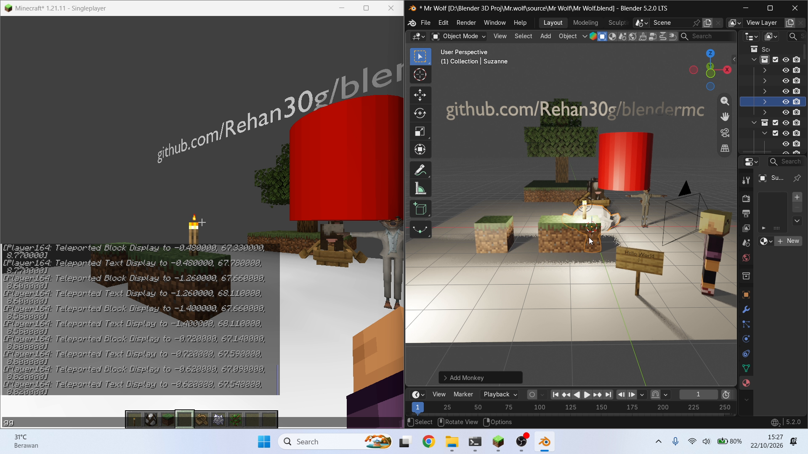
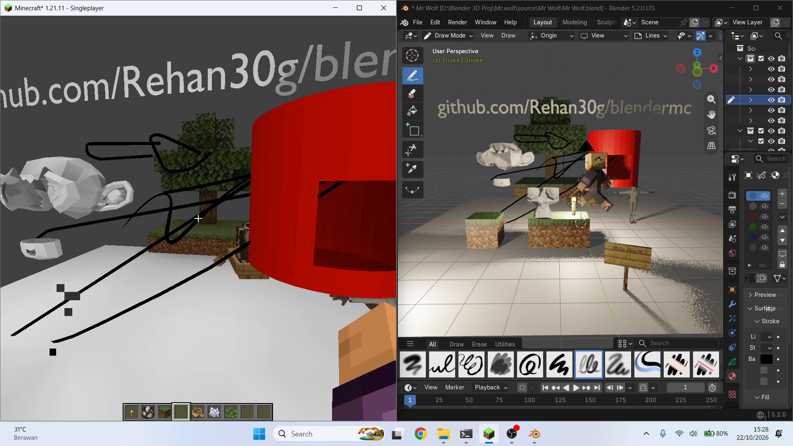
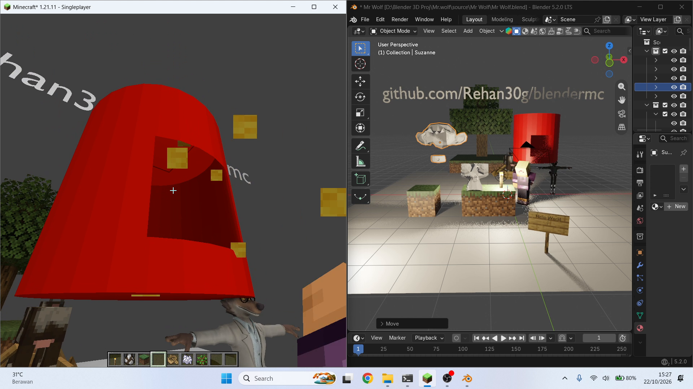
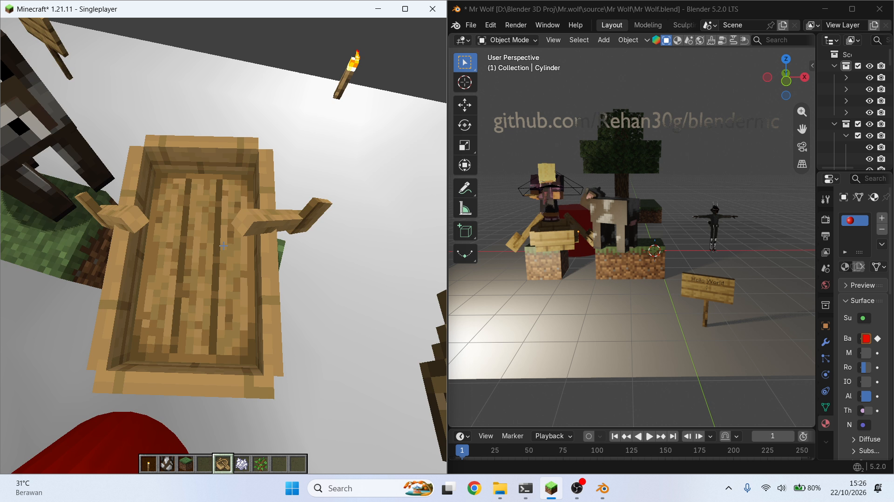

# blendermc

Fabric mod for Minecraft 1.21.11 that links the game to a running Blender. The scene open in Blender is a level in the game, rebuilt as you edit it, and what happens in the game shows up in Blender.

Side project, nothing serious. Most of the code was written with Claude Opus 5.5 in Claude Code. Expect rough edges.



Demo, one continuous screen recording (1:47): [docs/media/demo.mp4](docs/media/demo.mp4)

## What goes across

Blender to the game:
- mesh objects after their modifiers, with materials and textures
- grease pencil drawings (strokes and fills, animated with the timeline)
- lights, with their colour, as real light in the game
- the World as the sky (plain colour or a small HDRI skybox)
- the viewport camera, shown in the game as a marker

The game to Blender:
- the player, mobs and boats, animated
- placed blocks with their real models, signs with their text
- dropped items, TNT and its explosion, falling blocks, held items
- light-emitting blocks as lights
- cells broken in the game, cut out of the Blender objects

Levels are meshes, not blocks: collision is per triangle, cells can be broken and placed back, and lighting is baked on the CPU.

How it works, every option, and the wire protocol: [docs/BLENDER-LIVE.md](docs/BLENDER-LIVE.md).

## Screenshots

| | |
|---|---|
|  |  |
| Grease pencil strokes drawn in Blender show up in the game. | A hole mined in the game is cut out of the mesh in Blender. |
|  | |
| Mobs and boats from the game, animated in Blender. | |

## Running it

Java 21 and Blender 5.2.

```
gradlew runLiminalClient
```

Install the add-on by copying `tools/blender/blendermc_live` into `%APPDATA%\Blender Foundation\Blender\5.2\scripts\addons\` and enabling it. Open a world in the game, then in Blender's 3D view sidebar (N), BlenderMC tab, click Connect and then Put player in level. Restart Blender after updating the add-on.

On my machine this folder sits inside a bigger Gradle build so the Minecraft cache is shared. Cloned on its own, `settings.gradle` and `gradle.properties` make it a standalone build.

## Layout

```
src/main/java/dev/blendermc/
  live/            the link: socket server, levels built from Blender
  liminal/         mesh levels: loading, cells, collision, light baking
src/client/java/dev/blendermc/
  client/          what the client sends to Blender (block models, entities, items)
  liminal/client/  mesh renderer and baker
tools/blender/blendermc_live/  the Blender add-on
docs/BLENDER-LIVE.md
```

## Limitations

- Development environment, singleplayer and localhost only.
- Light colour affects the level mesh only; entities and vanilla blocks use the vanilla lightmap.
- Held items use an approximate pose.
- Signs use Blender's default font; animated textures show their first frame.

## Credits

Code mostly by Claude Opus 5.5 (Claude Code); ideas and testing by me. Built on Fabric, Fabric API, Sodium and Mod Menu.

No license. All rights reserved.
